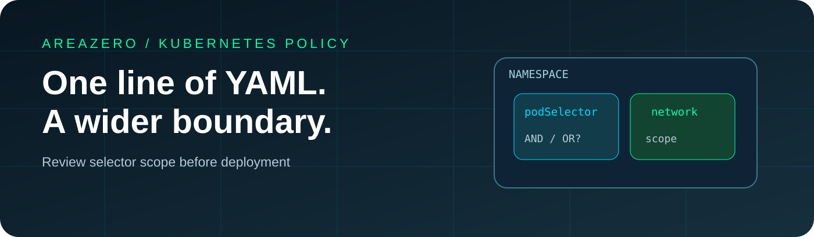
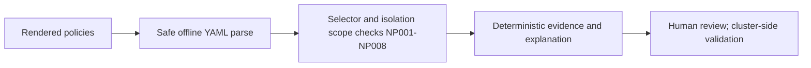

<p align="center"></p>
<p align="center"></p>

# Kubernetes NetworkPolicy Scope Audit

**The difference between one YAML list item and two can change who can talk to your Pods.** An offline Agent Skill that flags broad `podSelector`, `namespaceSelector`, IP CIDR, peer and port scopes; explains default isolation and the OR-vs-AND selector trap; and produces deterministic review evidence without connecting to your cluster.

[](https://github.com/Kanompung1988/k8s-netpol-scope-audit/actions/workflows/ci.yml) · [Agent Skills](https://agentskills.io/specification) · [Rules](references/RULES.md) · [Kubernetes sources](references/SOURCES.md) · [MIT license](LICENSE)

## Why this exists

Kubernetes NetworkPolicies are additive. Their `from`/`to` array entries are alternatives, while `namespaceSelector` and `podSelector` **inside one entry** are combined. Missing `policyTypes` has defaults; a missing peer list inside an allow rule means any peer. These are easy review mistakes even when YAML parses correctly. This tool surfaces the ambiguous-looking choices as **questions**, not as claims of live exploitability.



## Quickstart

```bash
git clone https://github.com/Kanompung1988/k8s-netpol-scope-audit.git
cd k8s-netpol-scope-audit
python -m pip install -r requirements.txt
python scripts/audit.py examples/safe-policy.yaml --format json --fail-on high
python scripts/audit.py examples/review-policy.yaml --format markdown --fail-on none
# Review your own rendered YAML locally without uploading it:
python scripts/audit.py ./rendered/networkpolicies.yaml --fail-on high
```

**Exit codes:** `0` = none at/above threshold; `2` = review findings; `1` = malformed or unsupported input. `--fail-on none` is report-only. Input parsing is bounded to 1 MB/200 policies, uses PyYAML SafeLoader and makes no network calls.

### Reproducible scenario

The bundled `review-policy.yaml` deliberately includes a namespace-wide target, a rule that allows all peers, an all-namespace peer, separate OR-selectors, an all-address CIDR and unbounded ports. The `safe-policy.yaml` fixture limits a payments namespace database to app=api sources on TCP 5432, *within the static scope of that single policy*. Even a clean result is **not** a claim the cluster enforces this scope: other NetworkPolicies may allow more traffic and service translation can affect IP matching.

## Install for Claude Code and Codex

| Runtime | Project-local install |
|---|---|
| Claude Code | `mkdir -p .claude/skills && git clone --depth 1 https://github.com/Kanompung1988/k8s-netpol-scope-audit.git .claude/skills/k8s-netpol-scope-audit` |
| Codex | `mkdir -p .agents/skills && git clone --depth 1 https://github.com/Kanompung1988/k8s-netpol-scope-audit.git .agents/skills/k8s-netpol-scope-audit` |

**Suggested prompt:** “Before merging this Kubernetes deployment, review the rendered NetworkPolicies with k8s-netpol-scope-audit. Explain `podSelector`, peer OR/AND, unbounded namespaces and ports, default-deny directions, actual blind spots and exact risk locations without contacting the cluster.”

## Evidence and constraints

- Files: `SKILL.md`, `scripts/audit.py`, `tests/test_audit.py` (**26 tests**), `examples/*.yaml`, `references/`, `.github/workflows/ci.yml`, MIT LICENSE and original SVG hero.
- GitHub Actions test matrix: Python 3.10 and 3.12 plus safe/unsafe CLI fixture checks. Verify via the badge and run log; no claim of independent external review or official `skills-ref` validation.
- False positives (intentional all-namespace allow) and false negatives (indirect implications, label matching across cluster, service/NAT behavior) remain possible. The agent must never claim live reachability or blanket isolation based on only local YAML.

## Licensing, attribution and security

Original code and docs © 2026 AREAZERO Skill Lab, MIT. The owner-provided Area Zero logo is not sublicensed under MIT; replacing brand marks is required for unaffiliated forks. Primary semantics credited in [SOURCES](references/SOURCES.md). See [SECURITY](SECURITY.md) and [CONTRIBUTING](CONTRIBUTING.md).
